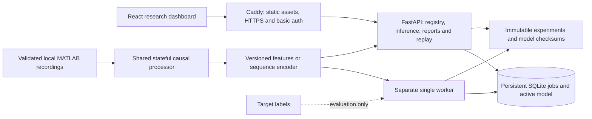

# Architecture

One host owns the writable artifact/state directory. API and worker share SQLite WAL and immutable experiment folders. A transactional claim permits one running job; the bounded queue permits four pending/running jobs. A live worker heartbeat prevents premature lease recovery during fitting. A dead worker's job becomes failed after lease expiry; its experiment checkpoints can be resumed explicitly. Cancellation is cooperative between feature batches/folds, not forced process termination.

The API process does not train models. Blocking MATLAB/ML work uses synchronous FastAPI handlers in the thread pool. MATLAB array caching is bounded to ten files; small validated subject metadata is cached with modification-time invalidation. Changing recordings requires restarting consumers and recomputing experiment fingerprints; do not replace source files during an experiment.

`CausalProcessor` owns one cue-triggered outward phase, fixed channels, calibration state, high-pass filter state, onset crossing/confirmation and an observation window. Buffers are limited to 2,048 samples; chunk order and shape are checked. Experiments and HTTP/WS inference use the same processor/feature semantics. A prefix-invariance test modifies future samples and verifies unchanged decisions. Legacy diagnostics remain separately labeled retrospective.

Model registry loads only compatible logistic/100 ms model IDs from project artifact directories. It checks versions, feature count/order contract, classes and SHA256 before trusted pickle loading. The final full-cohort serving refit is distinct from held-out fold models. Published report JSONs provide readable scientific evidence on a clean clone without distributing raw recordings or generated binaries.

HTTP bodies and replay control messages are bounded to 64 KiB; API requests have a single-host rate limit, and replay allows four sessions. Each replay carries sequence/sample indices, source sample timing and server monotonic timing; state is discarded on disconnect. Five idle minutes close a paused/completed session. Clients retain at most 512 displayed samples. Replay speed only changes scheduling.

Deployed mode fails closed unless the proxy supplies a server-only token and authenticated user header. Caddy validates basic auth, overwrites those headers and removes incoming Authorization before forwarding. API/worker ports are internal in Compose. No frontend secret is used. For cloud HTTPS, supply a valid domain pointing at the EC2 EIP. HTTP mode is loopback development only. All researchers currently share one authorization role; this course deployment is not a multi-tenant service.

Cloud path: EC2/SSM, encrypted persistent EBS, private versioned S3 prefixes and CloudWatch logs/metrics. S3 stores authorized datasets, release archives, derived artifacts and backups. There is no distributed database/queue, multi-host failover or zero-downtime update guarantee. The retained root volume and versioned backups need explicit lifecycle management.
