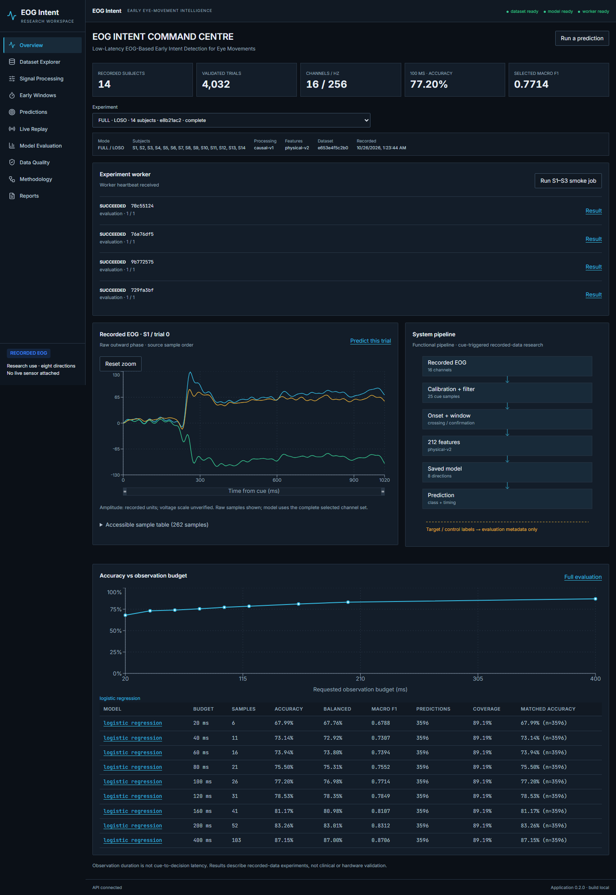

# Verification report

Executed locally on Windows, Python 3.10.9 / Node 22.17.1, 2026-10-26. These are observed results, not estimates. Current runtime pins include FastAPI 0.162.0, Starlette 1.7.0, sklearn 1.5.2, NumPy 1.24.4, SciPy 1.15.3 and joblib 1.4.2. Runtime constraints record the audited Windows dependency closure; Linux-only dependencies still require the container CI gate.

| Gate / command | Observed result |
|---|---|
| `cd backend; .\.venv-clean\Scripts\python.exe -m pip install -r requirements-dev.txt` | Isolated environment installed/resolved successfully; `pip check`: no broken requirements |
| `cd backend; .\.venv-clean\Scripts\python.exe -m pytest -q` | **47 passed, 1 skipped**, 8.31 s; optional Torch test skipped in this runtime |
| `cd backend; .\.venv\Scripts\python.exe -c "import torch; import pytest; raise SystemExit(pytest.main(['-q']))"` | **48 passed** including TCN in the dedicated optional-Torch environment; this environment retains historical sklearn 1.3.2 |
| Set `EOG_DATASET_ROOT` to a nonexistent folder, then run clean-runtime pytest | **39 passed, 9 skipped**, 2.07 s; skips are real-data gates plus optional Torch, not synthetic substitutes for real evaluation |
| `python -m scripts.inspect_dataset` | All 14 subjects passed, zero anomalies; new uniquely named report, historical report preserved |
| `python -m scripts.verify_artifacts` | 4,032 actual trials; all 70 source hashes match; five published full reports checked for split separation/counts/matching invariants |
| `python -m scripts.benchmark_serving` | All 20 real S1 trial CLI/API predictions and decision indices match; median warm HTTP 29.44 ms; scope/definitions in `results/serving_benchmark.json` |
| `cd frontend; npm run lint` | Pass, zero lint warnings |
| `cd frontend; npm run build` | TypeScript + Vite pass; initial JS 273.92 kB / 87.89 kB gzip, charts lazy-loaded; no large-chunk warning |
| `cd frontend; npx playwright test` | **10 passed**, 37.3 s; actual API/worker plus explicitly labeled boundary fixtures |
| `cd frontend; npm audit` | Zero known vulnerabilities |
| `cd backend; .\.venv-clean\Scripts\python.exe -m pip_audit -r requirements.txt --format json` | Zero known vulnerabilities; machine-readable snapshot in `results/dependency_audit.json` |
| `.\backend\.venv-clean\Scripts\python.exe ops/smoke_proxy.py` | Pass: actual production Caddy config, auth/static/API readiness/inference/export, unauthenticated/forged-header denial, real WS continuity and identical scores |
| `terraform init -backend=false`, `terraform validate` | Pass with Terraform 1.14.0 / AWS provider 6.70.0; lockfile committed |
| `terraform test` | One mocked-provider plan passed: private/versioned bucket, IMDSv2/encrypted EBS, proxy-only ingress; **no AWS resources** |
| YAML parsing; UTF-8/LF bootstrap check; `git diff --check` | Pass; Compose/workflows parse, bootstrap has no BOM/CRLF, no whitespace errors |
| Historical artifact comparison / Git candidate scan | Twelve original model/report artifacts unchanged (JSON comparison normalizes checkout line endings); no raw data, environments, tools or files above 10 MB in Git candidates; no key/token signatures detected |

Scientific tests cover malformed source phases/termination, duration/channel bounds, physical feature flags/order, prefix invariance, chunk/filter equivalence, calibration/confirmation delay, model round trip/corruption/target independence, matched training/test cohorts, training-only inner selection, durable queue claims/cancellation/dead-worker recovery/failure, deployed authorization, malformed replay messages and cleanup. Readiness now requires validated source schema/counts and a compatible model, rather than only existing directories.

The public frontend boundary tests use explicit fixtures to test empty data/models and historical four-/36-class metadata. They are not reported as real-data benchmarks. Real browser flows cover all ten routes, trial 287, actual inference/provenance, stale-result clearing, a submitted worker job followed by its own ID, export, replay pause/play/reset/speed/disconnect, backend failure/recovery, drawer focus/Escape, reduced motion and intentional table scrolling. Desktop 1440x900 and mobile 390x844 screenshots were rendered and visually inspected; no page-wide overflow was observed.

Actual [prediction desktop](screenshots/prediction-desktop.png) and [mobile overview](screenshots/overview-mobile.png) are also included. No screenshot of a supplied reference design was available; comparison used the written design requirements. Numerical values update directly; replay does not animate invented activity.

## ML evidence

Full fixed classical comparison: 378 folds (3 families x 9 budgets x 14 subjects). Matched-cohort logistic comparison: 126 folds with the same 3,596 eligible trial pool at every budget. Final nested-selection primary: 14 folds, **77.8393% accuracy / 0.779398 macro F1**, 3,610 eligible predictions / 4,032 source trials. TCN: 14 folds, **76.2327% / 0.762474**, same 3,610 eligible trials. Exact IDs, per-subject outputs, support, uncertainty and versions are in published JSONs and EXPERIMENTS.md. Historical reproduction matched stored scores; historical 1,000 ms results are not a matched comparison.

## Explicit unrun gates and limits

| Gate | Status and reason |
|---|---|
| Docker Compose/container build and clean Linux container smoke | **NOT RUN locally**: Docker is not installed. `verify.yml` contains build/health/auth checks. Native Caddy smoke proves proxy behavior, not image execution. |
| Real AWS account plan/apply, EC2 bootstrap, S3 transfer, TLS domain, cloud smoke | **NOT RUN**: account/credentials, region/budget approval, domain and dataset transfer permission were not provided. No resources or raw-data uploads occurred. |
| Remote GitHub Actions result | **Not observed during local verification**; workflow files are prepared, not a claimed remote pass. |
| Connected sensor, physical acquisition timing, clinical/external validation | **NOT RUN**: only supplied recordings and the local computer were available. |
| GRU/LSTM/ST-CNN, regression, adaptation, calibrated stopping | **Not implemented**; optional research extensions, not completed features. |

AWS status is independently **prepared / locally validated / not deployed / not cloud-verified**. Local real-data API, job, inference, replay, proxy and browser paths passed. Docker/cloud acceptance remains open and must not be inferred from local tests.

Known non-failing warnings: Starlette's test-client HTTPX deprecation, sklearn's pinned `multi_class` deprecation; historical environment also reports multipart deprecation. PyTorch loads successfully when imported before other scientific DLLs on this Windows installation; importing it late can produce `c10.dll` initialization errors. Serving has no Torch dependency. Dataset voltage scale/license and external validity remain unverified.
